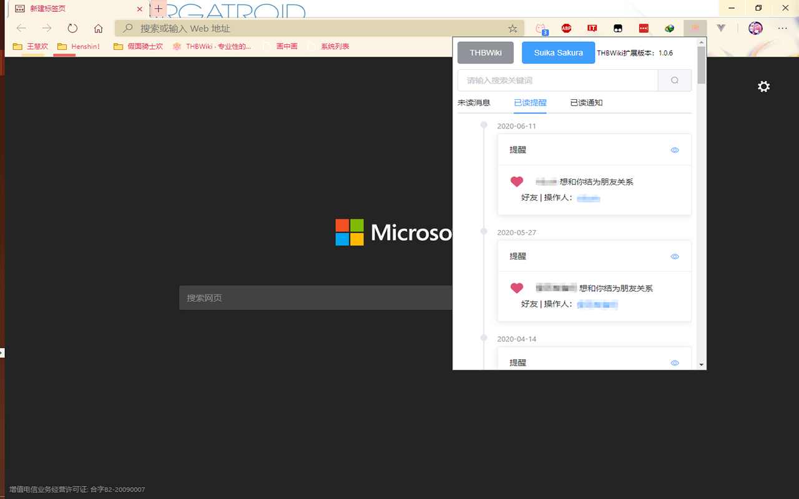
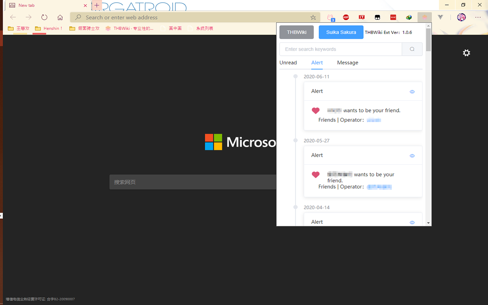

# Unofficial THBWiki Chrome Extension

非官方的THBWiki Chrome扩展

`此为重构版`

* 原版：[Chrome应用商店地址](https://chrome.google.com/webstore/detail/thbwiki-ext/calbmbmnknigdlkgioncbphnlelogplc)
* 新版：[Chrome应用商店地址](https://chrome.google.com/webstore/detail/%E6%88%91%E7%9A%84thbwiki/lnkednmkgfdplofejofihipleepenmcg) | [Edge应用商店地址](https://microsoftedge.microsoft.com/addons/detail/%E6%88%91%E7%9A%84thbwiki/kedhgbnbdipdblihompogcbbodbagfng)（本扩展）

## 重构内容

* 从MV2升级至MV3
* 使用Vite构建插件
* 因MV3合规问题，需要逐步重构功能

## 功能列表

* [ ] 面板支持显示用户信息
* [ ] 面板支持查看未读、已读通知
* [ ] 高级扩展功能
* [ ] 浏览器通知未读通知
* [ ] 个人JS支持

## 预览

### 中文版

### 英文版

